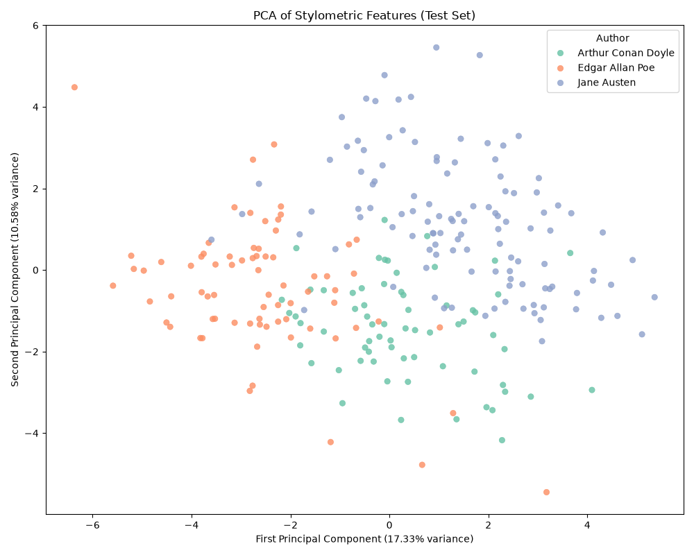
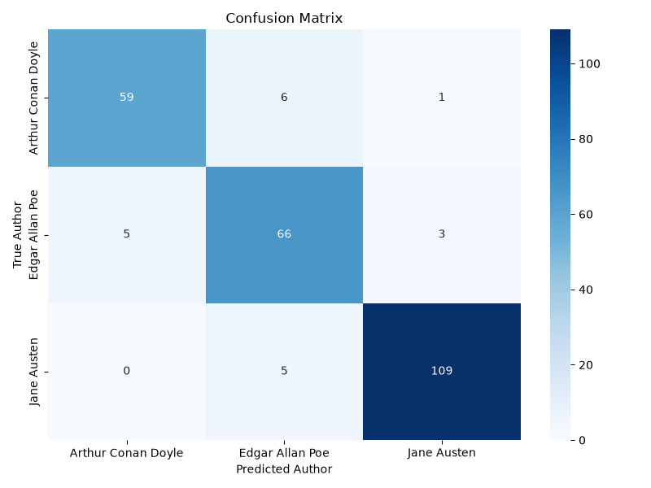

# 🕵️‍♂️ The Writing Detective

> **Stylometric Authorship Attribution using Classical ML**

Can a machine identify an author not by the words they write, but by *how* they write them? 

**The Writing Detective** is an end-to-end Machine Learning pipeline that classifies text excerpts into three classic authors (Arthur Conan Doyle, Jane Austen, and Edgar Allan Poe) based purely on non-semantic linguistic features. Instead of relying on TF-IDF or Word2Vec (which learn plot and character names), this project models the subconscious stylistic fingerprints of the authors.

---

## 📊 Key Results

- **92% Test Accuracy** across the three authors on 500-word blind excerpts.
- **Model Selection:** Logistic Regression systematically outperformed tree-based models like Random Forest. 
  - *Why?* Stylometric features (like linguistic ratios and punctuation densities) form smooth, continuous distributions. Linear classifiers are exceptionally good at discovering global hyperplane boundaries across these continuous variables, whereas Decision Trees struggle with axis-aligned, stepped splits on highly correlated continuous ratios.

## ⚙️ The Feature Engineering Breakdown

Our custom Scikit-Learn `StylometricFeaturesExtractor` ignores semantics and focuses on the subconscious scaffolding of language to construct a dense numerical matrix:

1. **Punctuation Densities:** Frequencies of commas, periods, semicolons, colons, question marks, and exclamation points per 1,000 characters.
2. **Function-Word Frequencies:** Ratios of 20 highly common, subconscious grammatical connectors (e.g., 'the', 'and', 'of', 'to', 'in').
3. **POS-Tag Ratios:** Density of Nouns (NN), Verbs (VB), Adjectives (JJ), and Adverbs (RB) using NLTK's Averaged Perceptron Tagger.
4. **Sentence Variance:** The mean length and standard deviation of sentences (e.g., Poe's staccato bursts vs. Austen's flowing paragraphs).

## 📈 Visualizations

The stylistic fingerprints of the authors become highly distinguishable once projected into lower dimensions.


*2D Principal Component Analysis (PCA) showing distinct author clustering based purely on linguistic structure.*


*Confusion Matrix on the 20% hold-out test set.*

## ⚠️ Error Analysis & Limitations

While highly accurate on 500-word chunks, the model exhibits known edge cases:
- **Sample-Size Variance (Short Passages):** Excerpts under 100 words are prone to severe stylometric variance. For instance, short staccato bursts in Poe's *The Tell-Tale Heart* are occasionally misclassified as Conan Doyle due to sudden spikes in first-person pronoun usage and shortened sentence lengths.
- **Dialogue vs. Narrative:** Passages heavily dominated by dialogue can warp punctuation densities (especially quotation marks and exclamation points), temporarily disguising the author's narrative baseline.

---

## 🚀 Installation & Usage

### 1. Install Dependencies
Ensure you have Python 3.8+ installed, then run:
```bash
git clone https://github.com/yourusername/writing-detective.git
cd writing-detective
pip install -r requirements.txt
```

### 2. Run the Interactive Detector (`detect.py`)
Run the interactive detection script to test the model against any random paragraph of text! 

```bash
# Option A: Interactive prompt (best for pasting long paragraphs)
python detect.py

# Option B: Pass text directly
python detect.py --text "It is a truth universally acknowledged, that a single man in possession of a good fortune, must be in want of a wife."
```

**Sample Output:**
```text
==================================================
WRITING DETECTIVE ANALYSIS
==================================================

=> PREDICTED AUTHOR: Jane Austen

=> CONFIDENCE SCORES:
   Jane Austen: 76.2%
   Arthur Conan Doyle: 14.1%
   Edgar Allan Poe: 9.7%

=> TOP 3 DRIVING STYLISTIC FEATURES:
   - Unusually high fw of ratio
   - Unusually low punct ! density
   - Unusually high pos NN ratio

==================================================
```
